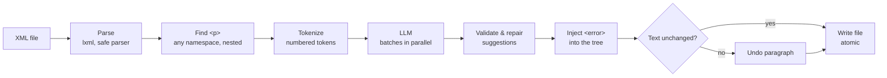

# XML Proofreader

A command-line tool that proofreads the `<p>` elements of an XML file with a GenAI model
and marks each mistake with an `<error>` tag, **without changing a single character of the
original text**.

```xml
<!-- input -->
<p>sarah lives in paris france? She enjoy french food.</p>

<!-- output -->
<p><error type="capitalization" correction="Sarah">sarah</error> lives in <error type="capitalization" correction="Paris, France.">paris france?</error> She <error type="grammar" correction="enjoys">enjoy</error> <error type="capitalization" correction="French">french</error> food.</p>
```

Remove every `<error>` tag from the output and you get the input back, byte for byte.

**Highlights**

- Works with any LangChain chat model: **Gemini** (default), **OpenAI**, **Anthropic**, or
  **Ollama** running locally for free.
- The model never writes XML. It only points at mistakes; code validates every suggestion,
  edits the tree, and **verifies the text is unchanged**, undoing the edit if not.
- Locale-aware (`--lang en-GB`, `--lang fr`, …), parallel requests, smart retries, and a
  performance summary after every run.
- 200+ offline tests, plus an evaluation script that scores models against a reference.

---

## Contents

- [Quick start](#quick-start)
- [Usage](#usage)
- [Choosing a model](#choosing-a-model)
- [How it works](#how-it-works)
- [Design decisions](#design-decisions)
- [Results](#results)
- [Performance](#performance)
- [Optional: error reasons (extra credit)](#optional-error-reasons-extra-credit)
- [Development](#development)
- [Known limitations](#known-limitations)

---

## Quick start

Requirements: Python 3.11+, [uv](https://docs.astral.sh/uv/), and a
[Gemini API key](https://aistudio.google.com/apikey) (or Ollama, see below).

```bash
git clone https://github.com/ludeesha-cse/xml-proofread.git
cd xml-proofreader
uv sync                      # creates .venv and installs dependencies
cp .env.example .env         # then paste your GOOGLE_API_KEY into .env

uv run proofread samples/input.xml --lang en
# -> writes samples/input.corrected.xml and prints a summary
```

---

## Usage

```bash
uv run proofread INPUT.xml [OPTIONS]
```

The output is written next to the input as `INPUT.corrected.xml`.

| Option | Default | Description |
|---|---|---|
| `--lang`, `-l` | `en` | BCP-47 language tag: `en`, `en-GB`, `fr`, `de`, … |
| `--model`, `-m` | `$PROOFREAD_MODEL`, else `google_genai:gemini-3.6-flash` | Model as `provider:model_name` |
| `--output`, `-o` | `INPUT.corrected.xml` | Output path |
| `--batch-size` | `10` | Paragraphs per LLM request |
| `--concurrency` | `4` | LLM requests in parallel |
| `--max-retries` | `3` | Retries for errors that can go away (timeouts, rate limits, 5xx) |
| `--timeout` | `60` | Seconds per request |
| `--strict` | off | Fail the run if any paragraph can't be proofread |
| `--verbose`, `-v` | off | Debug logs |

Every run ends with a summary on stdout (logs go to stderr):

```
Summary
  Output:      samples/all_error_types.corrected.xml
  Model:       google_genai:gemini-3.5-flash-lite
  Paragraphs:  17 found, 14 proofread (0 duplicate), 0 failed
  Errors:      35 marked, 0 rejected
  LLM:         5 request(s), 8,127 input + 2,009 output tokens
  Time:        3.80s (parse 0.00s, proofread 3.59s, annotate 0.00s, write 0.00s)
  Peak memory: 130.8 MB
```

### Exit codes

| Code | Meaning |
|---|---|
| 0 | Success |
| 1 | Unexpected error (a bug: the log includes a stack trace) |
| 2 | Invalid configuration: language tag, model string, missing API key or package |
| 3 | Input file missing, unreadable, or not well-formed XML |
| 4 | Output file could not be written |
| 5 | The LLM could not be used: every request failed, or any failure with `--strict` |
| 130 | Interrupted (Ctrl+C) |

---

## Choosing a model

The model is configuration, not code. Set it with `--model` or `PROOFREAD_MODEL` in `.env`
(the flag wins). See [`.env.example`](.env.example) for every option.

| Provider | Example | Setup |
|---|---|---|
| Google Gemini (default) | `google_genai:gemini-3.6-flash` | `GOOGLE_API_KEY` |
| Ollama (local, free) | `ollama:qwen3:8b` | Install [Ollama](https://ollama.com), `ollama pull qwen3:8b` |
| OpenAI | `openai:gpt-5.4-mini` | `uv sync --extra openai`, `OPENAI_API_KEY` |
| Anthropic | `anthropic:claude-haiku-5-5` | `uv sync --extra anthropic`, `ANTHROPIC_API_KEY` |

Any other model supported by LangChain's `init_chat_model` works after installing its package.

> `uv sync` removes extras you didn't ask for. Use `uv sync --all-extras` to keep them all.

**Recommendations** (see [Results](#results)):

- `gemini-3.6-flash`: best quality, the default.
- `gemini-3.5-flash-lite`: fastest and cheapest, slightly lower recall.
- `ollama:qwen3:8b`: free and offline, good for developing the pipeline, but too weak to
  judge proofreading quality. Use `--concurrency 1` on a laptop.

---

## How it works



1. **Parse** the file with lxml, keeping comments, CDATA, namespaces, entities and
   processing instructions. Details lxml would lose (the XML declaration as written,
   Windows line endings, trailing whitespace) are saved and restored, so an unchanged
   file is written back **byte-identical**.
2. **Find** every `<p>` in document order, in any namespace, including nested ones.
3. **Tokenize** each paragraph into numbered tokens: words, punctuation and whitespace.
4. **Ask the model** which tokens are wrong. Paragraphs are sent in batches, several
   batches at once, and identical paragraphs only once. The answer must match a JSON schema
   (structured output): token range, the original text, the error type and the correction.
5. **Validate and repair** each suggestion: known type, valid range, an actual change, no
   overlaps, never crossing a tag boundary. Common model slips are fixed in code (see below).
6. **Inject** `<error>` elements by splitting lxml's `text`/`tail` strings.
7. **Verify** that the paragraph's text is still identical. If not (a bug), the paragraph is
   restored from a saved copy.
8. **Write** the file atomically (temporary file, then rename), so a crash can never leave
   a half-written output.

### Project structure

```
src/proofread/
├── cli.py            # command line: options, exit codes, summary
├── config.py         # validated, immutable run settings
├── pipeline.py       # the end-to-end flow for one file
├── xml_io.py         # safe parsing, byte-faithful writing, finding <p>
├── paragraph.py      # where a <p>'s text lives in lxml ("text slots")
├── tokenizer.py      # text -> numbered tokens -> character positions
├── prompts.py        # system prompt, worked examples, house style per language
├── schema.py         # the JSON schema the model must answer with
├── llm.py            # provider-specific model setup, retry policy
├── proofreader.py    # batching, concurrency, de-duplication, answer repair
├── injector.py       # validate, wrap, verify, undo
├── evaluation.py     # score an output against a reference
├── metrics.py        # timings, peak memory, token usage
├── models.py         # ErrorSpan and the five error types
└── exceptions.py     # error types with exit codes
scripts/
├── evaluate.py       # compare models: precision, recall, F1, time, tokens
└── show_errors.py    # print an output's <error> tags per paragraph
samples/              # the assignment's input/expected output, plus edge-case tests
tests/                # offline tests with a fake model; live tests with -m live
```

---

## Design decisions

**The model never writes XML.** Asking an LLM to return the annotated XML invites changed
letters, dropped spaces and broken markup. Instead the model returns structured data, and
deterministic code does every edit and then checks the result.

**Tokens, not character offsets or quotes.** LLMs count characters badly, and quoting the
text is ambiguous when a word appears twice. Numbered tokens are easy for the model to point
at. Whitespace is a token too, so a missing comma (`eggs toast` → `eggs, toast`) can be
marked on the space, exactly as in the assignment's example.

**Defense in depth.** Every model answer is distrusted:

| Layer | Catches |
|---|---|
| JSON schema (structured output) | Malformed answers, unknown error types |
| `original` text check | Off-by-one token numbers, repaired when the text appears exactly once |
| Space repair | `galleries , and` → `galleries, and`, when the model puts a comma on the word instead of the space |
| `validate_spans` | Out-of-range, overlapping, no-op, and tag-crossing suggestions |
| Text invariant check | Any remaining bug: the paragraph is restored from a saved copy |
| Skipped-paragraph check | A model answer that silently leaves out a paragraph |

**Retry only what can succeed.** Rate limits (429), server errors (5xx), timeouts,
connection problems and invalid output are retried with exponential backoff. A wrong model
name (404), bad key (401/403) or rejected request (400) fails at once with the reason.

**Locale-aware prompt.** `--lang` becomes a language name in the prompt ("English (United
Kingdom)"), and comma conventions are applied per language: English gets the serial comma
and the other conventions of the reference output; other languages follow their own rules.

**No test-set leakage.** The prompt's worked examples were written for the prompt, not taken
from `samples/input.xml`. A test fails if any three-word sequence of the sample appears in
the prompt.

**Safe XML parsing.** Entity expansion and network access are disabled, which blocks XML
external entity (XXE) attacks.

---

## Results

`scripts/evaluate.py` scores a model's output against `samples/expected_output.xml`. It
compares the **corrected text**, not the exact tags, so `paris france` → `Paris, France` as
one error or three scores the same.

- **Precision**: of the changes the model made, how many were right.
- **Recall**: of the errors in the reference, how many the model found.

Final results, 3 runs per model (Gemini 3 ignores temperature, so runs vary):

| Model | Precision | Recall | F1 | Exact paragraphs | Avg time | Tokens (in / out) |
|---|---|---|---|---|---|---|
| gemini-3.6-flash | 0.88 | **1.00** | **0.94** | 3.0 / 5 | 5.5 s | 1,797 / 651 |
| gemini-3.5-flash-lite | **0.93** | 0.87 | 0.90 | 2.0 / 5 | 5.0 s | 1,797 / 842 |
| gemini-3.1-flash-lite | 0.91 | 0.87 | 0.89 | 2.7 / 5 | 4–5 s* | 1,797 / 661 |
| ollama:qwen3:8b† | 0.75 | 0.40 | 0.52 | 1.0 / 5 | 32.7 s | 1,698 / 397 |

\* One run took 21 s because of network variance. † Measured with an earlier prompt, on an
M4 MacBook Pro with 16 GB.

**How the prompt improved, measured the same way:**

| Change | 3.5 Flash-Lite F1 | 3.6 Flash F1 |
|---|---|---|
| First prompt (new examples, no test leakage) | 0.81–0.83 | 0.86 |
| + house style (serial comma, comma before joined clauses, after introductory phrases) | 0.87 | 0.94 |
| + space-before-comma repair in code | 0.90 | 0.94 |

**The reference isn't perfect**, which caps precision below 1.0 for any correct model:

- It leaves `french food` uncorrected; every Gemini model fixes it to `French`.
- It adds a comma in `work hard, but they're` but not in `last summer and I loved`, though
  both join two independent clauses. 3.6 Flash applies the rule to both.

So 3.6 Flash's only "mistakes" on this sample are the reference's.

---

## Performance

- **Parallel requests:** on `samples/all_error_types.xml` with `--batch-size 3` (5 requests),
  `--concurrency 1` took 9.05 s and `--concurrency 4` took 3.80 s, about 2.4× faster.
- **Batching:** each request carries about 1,700 tokens of instructions, so larger batches
  use fewer tokens; smaller batches give more parallelism.
- **De-duplication:** identical paragraphs are sent once and the answer is reused.
- **No wasted work:** empty, number-only and CDATA paragraphs are never sent, and a wrong
  model name or key fails in about a second instead of retrying.
- **Memory:** peak RSS is about 110–130 MB, mostly Python and the libraries; the document
  itself is small in comparison.
- **Ollama:** the context window grows with `--batch-size`, because Ollama silently cuts off
  prompts that don't fit.

Timings depend on the network and the provider's load on the day; token counts are the
stable measure of work.

---

## Optional: error reasons (extra credit)

The tool can add a short explanation to each error:

```xml
<error type="capitalization" correction="John" reason="Proper nouns are capitalized.">john</error>
```

It's off by default, because it makes every answer longer (slower and more expensive).
To turn it on, uncomment two places:

1. `src/proofread/schema.py`, in `FoundError`:
   ```python
   reason: str = Field(description="Why this is an error, in at most 12 words.")
   ```
2. `src/proofread/injector.py`, in `_make_error`:
   ```python
   if span.reason:
       error.set("reason", span.reason)
   ```

The reason is already carried through the rest of the pipeline.

---

## Development

```bash
uv sync --all-extras          # all providers, plus pytest and ruff
uv run pytest                 # offline tests with a fake model (a few seconds)
uv run pytest -m live -v      # tests against the real model in PROOFREAD_MODEL
uv run ruff check . && uv run ruff format --check .
```

Compare models:

```bash
uv run python scripts/evaluate.py samples/input.xml samples/expected_output.xml \
  -m google_genai:gemini-3.6-flash -m google_genai:gemini-3.5-flash-lite \
  --runs 3 --show-differences
```

Inspect an output: `uv run python scripts/show_errors.py samples/input.corrected.xml`.

`samples/all_error_types.xml` covers every error type and the XML edge cases (inline tags,
nested `<p>`, namespaces, entities, comments, CDATA, empty paragraphs).

---

## Known limitations

- **Paragraphs containing CDATA are left unchanged.** Tags can't go inside CDATA, and
  lxml would turn `<![CDATA[a<b]]>` into `a&lt;b` if the paragraph were edited.
- **An error that crosses an inline tag** (half inside `<b>`) is rejected, not split.
- **Entity content isn't proofread.** `&co;` stays a reference; the text around it is checked.
- **Already-annotated paragraphs are skipped**, so running the tool on its own output
  changes nothing.
- **Not byte-identical in a few cases, but equivalent XML:** single-quoted attributes become
  double-quoted, character references like `&#233;` become the character, `<e></e>`
  becomes `<e/>`, whitespace between nodes outside the root element may change, and UTF-16
  files lose their `<?xml?>` declaration (the byte-order mark still identifies the
  encoding). Everything inside the root element is preserved.
- **Clarity is conservative by design:** only genuinely confusing text (like a dangling
  modifier or a repeated word) is flagged, never style preferences.
- **House style rules exist for English only.** Other languages follow their standard
  conventions as the model knows them.
- **Results vary between runs** for models that ignore `temperature` (Gemini 3).

---

## License

MIT, see [LICENSE](LICENSE).